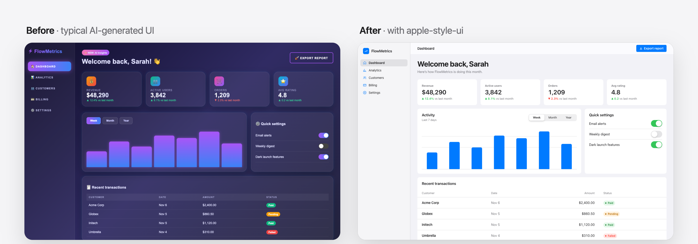
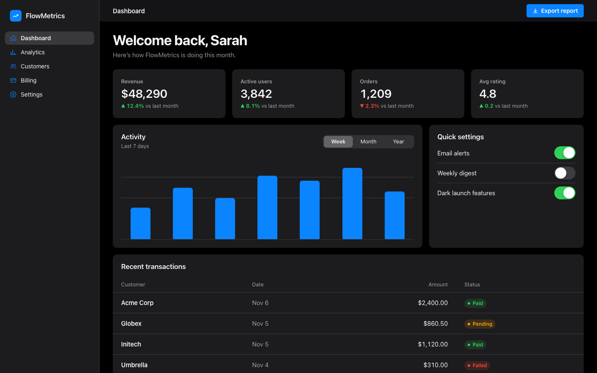
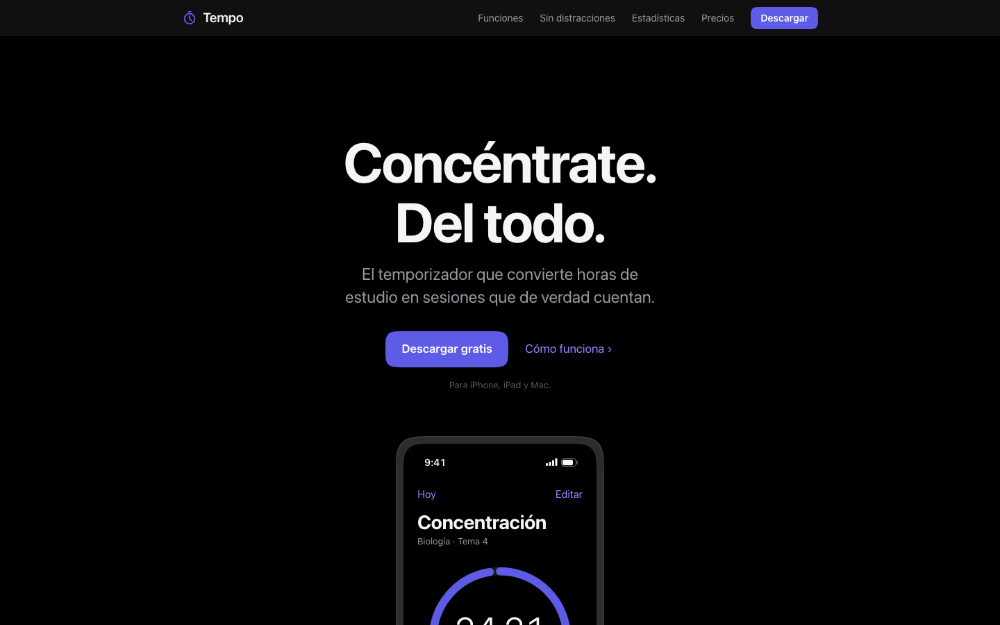
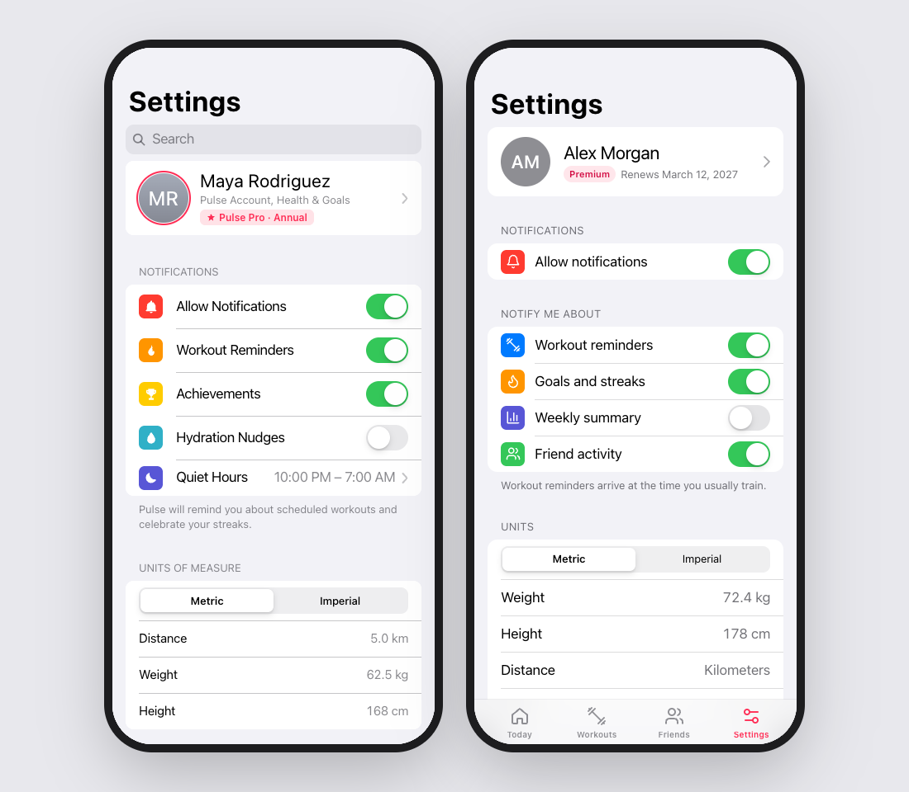

<div align="center">

# Apple-style UI

**Una skill de Claude que hace que cualquier interfaz parezca diseñada por Apple.**

Webs, paneles, pantallas de ajustes, apps móviles, nuevas o ya hechas.
Se instala una vez, y Claude deja de entregar la típica plantilla «hecha con IA» y empieza a entregar interfaces limpias, precisas y con nivel de Apple.

[Instalar](#instalar) · [Antes / después](#antes--después) · [English](README.md)

<br>



</div>

---

## Por qué

Pide a cualquier IA una «interfaz limpia y moderna» y te dará siempre lo mismo: degradados morados, tarjetas que brillan, iconos con emojis, texto gris de 14px y una etiqueta encima de cada titular.

Esta skill le da a Claude lo que ya saben los diseñadores de Apple:

- los colores del sistema para modo claro y oscuro,
- los estilos de texto de iOS,
- los materiales translúcidos,
- las esquinas concéntricas,
- las animaciones tipo muelle,
- las listas agrupadas,
- y la disciplina de **quitar** cosas.

Además incluye una lista de comprobación para detectar todo lo que «parece hecho con IA» antes de entregarlo.

Sirve para interfaces nuevas **y** para rediseñar la que ya tienes sin romper cómo funciona.

## Antes / después

La imagen de arriba es una prueba real: Claude rediseñó un panel genérico manteniendo los datos, los IDs y el JavaScript. Las pestañas, los interruptores y el botón de exportar siguen funcionando. El modo oscuro viene incluido:



**Mismo prompt, con y sin la skill:**

| Sin la skill | Con la skill |
|---|---|
|  |  |



Todos los ejemplos están en [`examples/`](examples).

## Instalar

### Claude Code (recomendado)

Escribe esto en Claude Code:

```bash
/plugin marketplace add Aduhax16/apple-style-ui-skill
/plugin install apple-style-ui@apple-style-ui-skill
```

Desde entonces, Claude usa la skill automáticamente cada vez que creas o rediseñas una interfaz. También puedes llamarla tú:

```text
/apple-style-ui:apple-style-ui haz que mi página de precios parezca de Apple
```

<details>
<summary><b>Instalación manual (copiar la carpeta)</b></summary>

```bash
git clone https://github.com/Aduhax16/apple-style-ui-skill.git
cp -r apple-style-ui-skill/plugins/apple-style-ui/skills/apple-style-ui ~/.claude/skills/
```

Si la copias en `~/.claude/skills/`, la tendrás en todos tus proyectos. Si la copias en `.claude/skills/` dentro de un proyecto, solo estará en ese proyecto. Se invoca con `/apple-style-ui`.

</details>

<details>
<summary><b>Claude.ai (web y app de escritorio)</b></summary>

1. Descarga [`apple-style-ui.zip`](https://github.com/Aduhax16/apple-style-ui-skill/raw/main/dist/apple-style-ui.zip).
2. Ve a **Customize → Skills**, sube el zip y actívala.
3. Pide cualquier interfaz. Claude la usará solo.

Necesitas tener activada la ejecución de código.

</details>

## Cómo se usa

Pide las cosas como siempre:

- *«Hazme una landing para mi app.»*
- *«Este panel parece genérico. Haz que parezca una app de Mac, sin romper nada.»*
- *«Hazme una pantalla de ajustes estilo iOS en SwiftUI.»*
- *«Añade modo oscuro y que no parezca hecho con IA.»*

## Qué incluye

- **`SKILL.md`**: el flujo de trabajo y las reglas clave de tipografía, color, espacio, forma, profundidad y movimiento.
- **`assets/tokens.css`**: los colores del sistema de iOS en claro y oscuro, los estilos de texto, el espaciado, los radios, los materiales, las sombras y las curvas de animación.
- **`references/components.md`**: 18 recetas con medidas exactas. Incluye la barra de navegación translúcida, los botones, las listas agrupadas, el control segmentado, el interruptor, la barra lateral, la barra de pestañas, las hojas modales, la portada al estilo apple.com, la cuadrícula tipo *bento* y los precios. También incluye los controles flotantes de **Liquid Glass**.
- **`references/frameworks.md`**: Tailwind v3/v4, shadcn/ui, MUI, Chakra, Bootstrap, Vue/Svelte, SwiftUI, UIKit/AppKit, Flutter y React Native.
- **`references/checklist.md`**: la revisión final, con 16 señales de «parece hecho con IA», los detalles de Apple, el modo oscuro, el móvil y la accesibilidad.

## Probada

La skill se probó con tres prompts reales, cada uno con y sin la skill. Con la skill superó el **95 %** de las comprobaciones automáticas, frente al **75 %** sin ella. Los detalles están en el [README en inglés](README.md#tested).

## Licencia

[MIT](LICENSE). Hecha por [Adu](https://github.com/Aduhax16).

Este proyecto no está afiliado, respaldado ni patrocinado por Apple Inc. Apple, iOS, macOS, SF Pro y SF Symbols son marcas de Apple Inc. La skill enseña principios de diseño descritos en las [Human Interface Guidelines](https://developer.apple.com/design/human-interface-guidelines/) públicas de Apple. No incluye ni redistribuye fuentes, iconos ni recursos de Apple.
