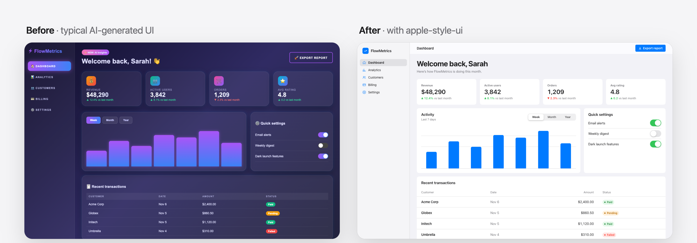
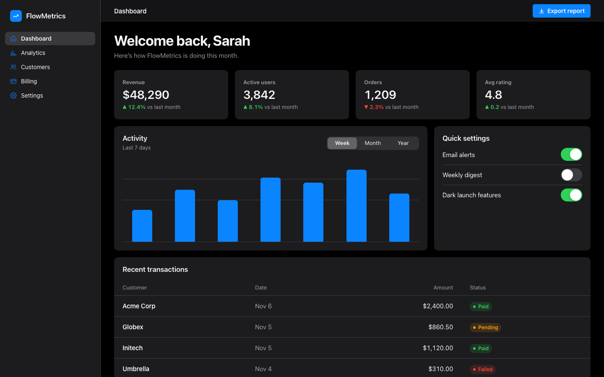
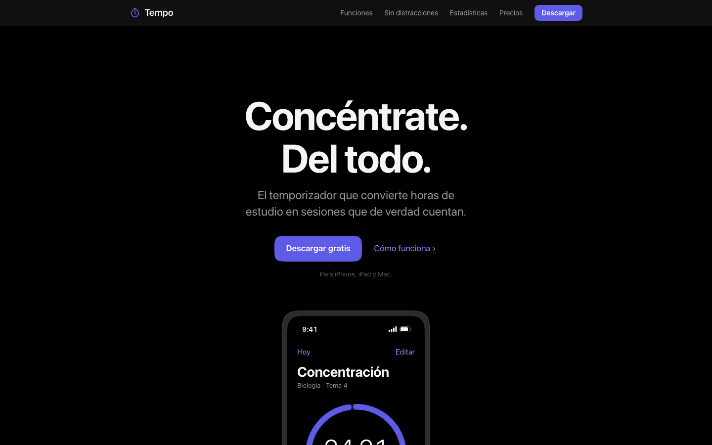
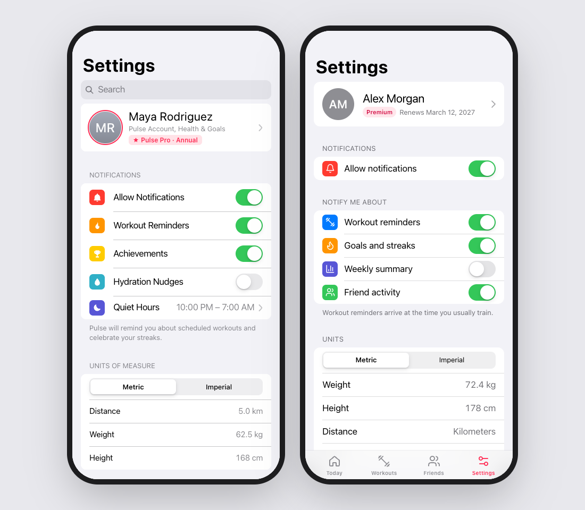

<div align="center">

# Apple-style UI

**A Claude skill that makes any interface look like Apple designed it.**

Websites, dashboards, settings screens, mobile apps. New or existing.
One install, and Claude stops shipping "AI-generated SaaS template" and starts shipping calm, precise, Apple-grade UI.

[Install](#install) · [Before / after](#before--after) · [What's inside](#whats-inside) · [Español](README.es.md)

<br>



</div>

---

## Why

Ask any AI for a "clean, modern UI" and you get the same thing every time: purple gradients, glowing cards, emoji icons, 14px gray text, a badge above every headline.

This skill gives Claude what Apple's designers already know: system colors for light and dark, the iOS text styles, translucent materials, concentric corners, spring motion, inset-grouped lists, and the discipline to **remove** things. It also gives Claude a checklist to catch the "looks AI-made" tells before you see them.

It works for brand-new UIs **and** for restyling the one you already have, without breaking its behavior.

## Before / after

**Restyling an existing UI.** The image above is a real run. The prompt was *"This dashboard looks like every other AI-generated SaaS template. Restyle it so it looks like a native Apple app. Keep all the functionality working."* The data, the IDs and the JavaScript are untouched, and the tabs, switches and export button all still work. Dark mode comes free:



**Same prompt, with and without the skill.** Today's Claude already knows roughly what "Apple-like" means. The skill makes it *consistent*: no gradient text sneaking into the hero, no emoji, real system colors, correct switch semantics and dark mode that holds up.

| Without the skill | With the skill |
|---|---|
|  |  |

<sub>Prompt: <i>"hazme una landing page para mi app Tempo, un temporizador de concentración para estudiantes… que quede súper limpia y premium, como si la hubiera hecho Apple"</i>. <a href="docs/images/landing-with-full.png">See the full page made with the skill →</a></sub>



<sub>Prompt: <i>"Build a settings screen for the mobile web version of my fitness app 'Pulse'… Should feel exactly like an iPhone."</i> Left: without the skill. Right: with it.</sub>

### Open the examples

Every page above is in [`examples/`](examples). Open them live, then flip your system to dark mode:
[Landing page](https://htmlpreview.github.io/?https://github.com/Aduhax16/apple-style-ui-skill/blob/main/examples/landing-page.html) ·
[iPhone settings](https://htmlpreview.github.io/?https://github.com/Aduhax16/apple-style-ui-skill/blob/main/examples/iphone-settings.html) ·
[Dashboard before](https://htmlpreview.github.io/?https://github.com/Aduhax16/apple-style-ui-skill/blob/main/examples/dashboard-before.html) →
[after](https://htmlpreview.github.io/?https://github.com/Aduhax16/apple-style-ui-skill/blob/main/examples/dashboard-after.html)

## Install

### Claude Code (recommended)

```bash
/plugin marketplace add Aduhax16/apple-style-ui-skill
/plugin install apple-style-ui@apple-style-ui-skill
```

That's it. Claude now uses the skill automatically whenever you build or restyle a UI. You can also call it directly:

```text
/apple-style-ui:apple-style-ui make my pricing page look like Apple made it
```

<details>
<summary><b>Manual install (copy the folder)</b></summary>

```bash
git clone https://github.com/Aduhax16/apple-style-ui-skill.git
cp -r apple-style-ui-skill/plugins/apple-style-ui/skills/apple-style-ui ~/.claude/skills/
```

Use `~/.claude/skills/` for all your projects, or `.claude/skills/` inside a single project. Invoke it with `/apple-style-ui`.

</details>

<details>
<summary><b>Claude.ai (web and desktop app)</b></summary>

1. Download [`apple-style-ui.zip`](https://github.com/Aduhax16/apple-style-ui-skill/raw/main/dist/apple-style-ui.zip).
2. Go to **Customize → Skills**, upload the zip and turn it on.
3. Ask for any interface. Claude picks the skill up on its own.

Code execution must be enabled in your settings.

</details>

<details>
<summary><b>Other agents (Cursor, Codex, Gemini CLI…)</b></summary>

The skill is plain Markdown plus one CSS file. Point your agent at `plugins/apple-style-ui/skills/apple-style-ui/SKILL.md`, or use the community [`skills`](https://github.com/vercel-labs/skills) CLI (third-party):

```bash
npx skills add Aduhax16/apple-style-ui-skill
```

</details>

## Use it

Just ask the way you normally would. The skill triggers on any UI work:

- *"Build a landing page for my app."*
- *"This dashboard looks generic. Make it look like a Mac app, keep everything working."*
- *"Make me an iOS-style settings screen in SwiftUI."*
- *"Redesign our pricing page, cleaner, more premium."*
- *"Add dark mode to this, and make it not look AI-generated."*

## What's inside

```
plugins/apple-style-ui/skills/apple-style-ui/
├── SKILL.md                  workflow + the core rules (type, color, space, shape, depth, motion)
├── assets/tokens.css         drop-in design tokens: iOS system colors (light + dark), text styles,
│                             spacing, radii, materials, shadows, spring curves
└── references/
    ├── components.md         18 recipes with exact measurements: translucent nav bar, buttons,
    │                         inset-grouped lists, segmented control, switch, fields, sidebar,
    │                         tab bar, sheets, menus, toasts, tables, charts, apple.com-style hero,
    │                         bento grid, pricing, Liquid Glass floating controls
    ├── frameworks.md         Tailwind v3/v4, shadcn/ui, MUI, Chakra, Bootstrap, Vue/Svelte,
    │                         SwiftUI, UIKit/AppKit, Flutter (Cupertino), React Native / Expo
    └── checklist.md          final pass: 16 "looks AI-generated" tells to remove, Apple details
                              to confirm, dark mode, mobile and accessibility checks
```

**What the skill does**

1. **Reads the situation.** Is this a new UI or a restyle? Which stack? Is it a marketing page (apple.com language) or app UI (iOS/macOS language)?
2. **Installs the foundation.** One token file, so colors, type and dark mode come out right everywhere. To rebrand, change `--accent`.
3. **Builds with recipes.** It uses the real measurements, not guesses: 17px body text, 44px hit targets, 51×31 switches, concentric radii, hairline separators inset to the text.
4. **Reviews.** It strips gradients, glows, emoji icons and extra font weights, then checks light and dark mode at phone width.

On native platforms (SwiftUI, UIKit, AppKit) it does the opposite of faking it: it uses the real system components, semantic colors, SF Symbols and materials, including `.glassEffect()` on iOS 26.

## Tested

The skill ships with an eval suite in [`evals/`](evals). It runs three real prompts (a Spanish landing page, a dashboard restyle, an iPhone settings screen), each with and without the skill, and checks the results automatically.

Each output is checked for no CSS gradients, no emoji, dark mode, the system font stack, translucent materials, `prefers-reduced-motion`, plus one case-specific check (behavior kept / switch semantics).

| Test | With skill | Without skill |
|---|:---:|:---:|
| Landing page (Spanish) | **6 / 6** | 4 / 6 (gradient headline, emoji) |
| Dashboard restyle | **6 / 7** | 6 / 7 |
| iPhone settings screen | **7 / 7** | 5 / 7 (gradient, no switch role) |
| **Total** | **95%** | **75%** |

<sub>The one gradient in the skill's dashboard draws the chart gridlines, not decoration. Testing also caught a bug in the skill itself: cards disappeared in dark mode. That bug is now a rule in the skill.</sub>

The case folders use the `claude plugin eval` format, so you can rerun them or add your own.

## Contributing

Issues and PRs are welcome, especially:
- recipes for more components (date pickers, steppers, charts)
- mappings for more frameworks
- before/after examples from your own projects

## License and credits

[MIT](LICENSE). Made by [Adu](https://github.com/Aduhax16).

This project is not affiliated with, endorsed by, or sponsored by Apple Inc. Apple, iOS, macOS, SF Pro and SF Symbols are trademarks of Apple Inc. The skill teaches design principles described in Apple's public [Human Interface Guidelines](https://developer.apple.com/design/human-interface-guidelines/). It does not include or redistribute Apple fonts, icons or assets.
